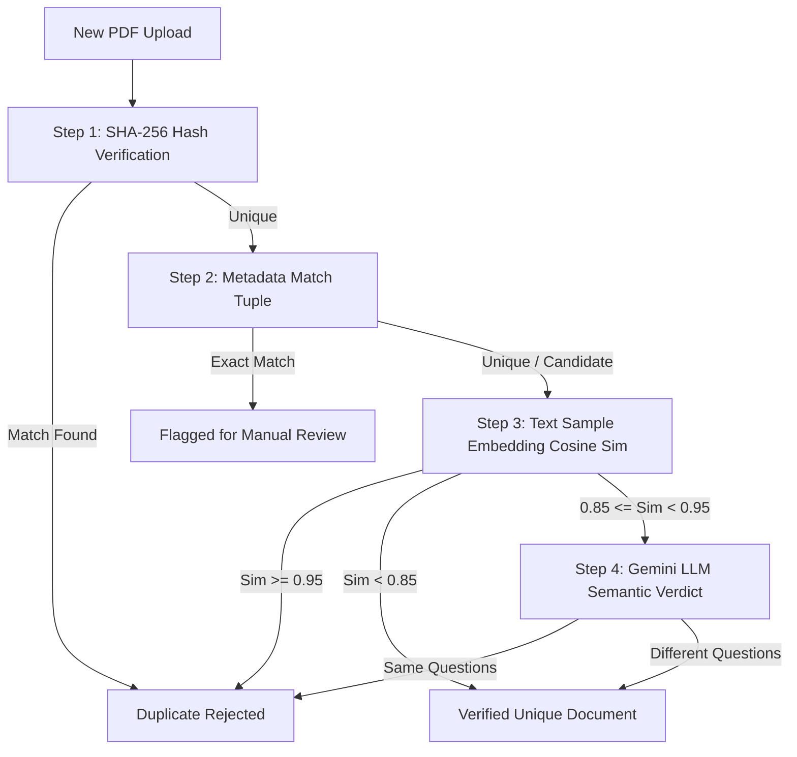

# PaperVault — Spatial Academic Digital Archive

[](https://react.dev)
[](https://vitejs.dev)
[](https://threejs.org)
[](https://tailwindcss.com)
[](https://firebase.google.com)
[](https://mozilla.github.io/pdf.js/)

> **PaperVault** is an academic digital archive and past-paper intelligence platform designed with a tactile, monochromatic 3D aesthetic ("Archive Noir"). It delivers search, automated AI paper analysis, duplicate detection, and responsive document rendering across desktop, tablet, and mobile devices.

---

## 1. Visual & Spatial Architecture ("Archive Noir")

PaperVault departs from conventional university portals by treating past question papers not as static lists, but as **physical artifacts within a spatial academic vault**.

```
    ┌─────────────────────────────────────────────────────────────┐
    │                      HERO SCENE 3D                          │
    │   Procedural Blueprint Canvas  •  Titanium Orbital Rings    │
    │     Delta-Time Spring Physics  •  Scroll Parallax Vectors   │
    └──────────────────────────────┬──────────────────────────────┘
                                   │
         ┌─────────────────────────┴─────────────────────────┐
         ▼                                                   ▼
┌─────────────────────────────────┐         ┌─────────────────────────────────┐
│       SPATIAL CARDS 3D          │         │      INTERACTIVE CHAMBERS       │
│ • translateZ layered sheets     │         │ • Chamber 01: Search Terminal   │
│ • Hover pitch/roll transforms   │         │ • Chamber 02: Document Deck     │
│ • Multi-tier depth shadows      │         │ • Chamber 03: Ingestion Port    │
└─────────────────────────────────┘         └─────────────────────────────────┘
```

### The 12-Shade Monochromatic Palette
The platform adheres to an uncompromising, distraction-free grayscale spectrum. No neon gradients or cheap rainbow glows:

| Tone | Hex | UI Role |
| :--- | :--- | :--- |
| **Deep Space** | `#000000` | Canvas base & deep backdrop |
| **Rich Obsidian** | `#050505` | Primary body background |
| **Charcoal Base** | `#0A0A0A` | Section & viewport container fills |
| **Graphite Dark** | `#101010` | Elevated surfaces & card backdrops |
| **Card Surface** | `#151515` | Default card & input background |
| **Border Dark** | `#1C1C1C` | Structural rules & hairline dividers |
| **Border Mid** | `#242424` | Interactive component borders |
| **Border Light** | `#333333` | Hover & focus boundary highlights |
| **Muted Grey** | `#555555` | Secondary metadata & captions |
| **Mid Grey** | `#777777` | Body descriptions & icons |
| **Silver Bright** | `#AAAAAA` | Emphasized metadata & subheadings |
| **Off-White** | `#D8D8D8` | High-contrast secondary text |
| **Pure White** | `#FFFFFF` | Primary headers & active highlights |

---

## 2. Core Capabilities

### 🔍 Academic Vault & Slot Filtering
- **Unified Querying**: Instantly search across course titles, catalog codes (e.g., `CSE1007`, `MAT2001`), semesters, and professor names.
- **Categorical Breakdown**: Filter papers seamlessly across **CAT-1**, **CAT-2**, **FAT**, and **Lab FAT**.
- **Slot Taxonomy**: Filter papers by time slot (`A1`, `B1`, `C1`, `D1`, `E1`, `F1`, `G1`, `L1-L6`, etc.).

### 🤖 Gemini AI Paper Analysis
- **Module Weightage Extraction**: Generates percentage-based topic distributions mapped against official syllabus requirements.
- **Recurring Question Identification**: Detects repeated problems and formula patterns across past semesters.
- **High-Yield Exam Tips**: Summarizes revision priorities and tactical recommendations for exam prep.

### 🛡️ 4-Stage Ingestion & Duplicate Detection
To safeguard archive integrity, PaperVault uses an automated 4-tier verification ladder (cheapest and fastest operations first):



1. **SHA-256 Hash Verification**: Direct cryptographic hash check against indexed documents (instantaneous & free).
2. **Metadata Tuple Matching**: Scans for identical `(subject, examType, year, slot)` combinations.
3. **Vector Embedding Cosine Similarity**: Evaluates semantic similarity using `text-embedding-004` vectors.
4. **Gemini LLM Semantic Arbitration**: For ambiguous similarity scores (0.85 – 0.95), Gemini analyzes question ordering, marks allocation, and phrasing.

### 📄 WebWorker PDF Extraction
- Client-side PDF text extraction powered by `pdfjs-dist` (v6.x) running inside an isolated Web Worker (`pdf.worker.min.mjs`).
- Parses document headers, questions, and metadata without blocking UI rendering or 60 FPS spatial animations.

### 🛡️ Administration & Moderation Console
- **Moderation Queue**: Review, verify, or reject pending student submissions with inline PDF preview.
- **Exam Countdown Configurator**: Real-time timer broadcasted across the student dashboard.
- **Bulk Ingestion Suite**: Batch migrate archive manifests into Firestore entities without duplicate writes.
- **Syllabus & Notes Manager**: Manage curriculum modules and official course note bundles.

---

## 3. Technology Stack

| Layer | Technologies |
| :--- | :--- |
| **Frontend Framework** | [React 19](https://react.dev) + [React Router v7](https://reactrouter.com) |
| **Build & Tooling** | [Vite 8](https://vitejs.dev) + [Oxlint](https://oxc.rs) |
| **Styling & Motion** | [Tailwind CSS v4](https://tailwindcss.com) + CSS 3D Preserves + Lucide SVGs |
| **3D Rendering** | [Three.js](https://threejs.org) (WebGL procedural scene graph & spring physics) |
| **Document Processing** | [PDF.js](https://mozilla.github.io/pdf.js/) `pdfjs-dist@6.4.299` |
| **Backend & Database** | [Google Firebase v12](https://firebase.google.com) (Firestore & Google Auth) |
| **Asset Storage** | [Cloudinary](https://cloudinary.com) (Raw binary PDF storage) |
| **Artificial Intelligence**| [Google Gemini API](https://ai.google.dev) (`gemini-1.5-flash` + `text-embedding-004`) |

---

## 4. Project Directory Structure

```text
PaperVault/
├── public/                       # Static public assets
├── scripts/
│   └── prerender-subjects.mjs    # Static prerender generator for SEO & subjects
├── src/
│   ├── 3d/
│   │   ├── FloatingSpace.jsx     # Spatial 3D primitive system (Frames, Rings, Sheets)
│   │   └── HeroScene.jsx         # WebGL Three.js interactive canvas scene
│   ├── ai/
│   │   ├── duplicateCheck.js     # 4-stage duplicate detection pipeline
│   │   └── gemini.js             # Gemini 1.5 Flash client & embeddings
│   ├── components/
│   │   ├── atoms.jsx             # Core design system atoms (Button, Card, Input, Gates)
│   │   ├── Navbar.jsx            # Monochromatic frosted navigation bar
│   │   ├── PaperCard.jsx         # Layered 3D paper card with tactile open preview
│   │   ├── SearchHero.jsx        # Spatial hero header with integrated search terminal
│   │   ├── SubjectCard.jsx       # 3D interactive subject catalog card
│   │   └── sections.jsx          # Chamber sections (HowItWorks, ExamCountdown, Footer)
│   ├── firebase/
│   │   ├── config.js             # Firebase client SDK initialization
│   │   └── db.js                 # Firestore CRUD operations & queries
│   ├── lib/
│   │   └── cloudinary.js         # Cloudinary raw PDF upload & asset management
│   ├── pages/
│   │   ├── admin/                # Admin Console (Dashboard, Moderation, BulkImport, etc.)
│   │   ├── Chat.jsx              # Community discussion channels
│   │   ├── Home.jsx              # Landing page & curated archive discovery
│   │   ├── MyUploads.jsx         # User contribution management & tracking
│   │   ├── PaperDetail.jsx       # Document viewer, AI insights, and similar papers
│   │   ├── Papers.jsx            # Subject catalog & paper filter view
│   │   ├── Requests.jsx          # Missing paper request board & voting
│   │   ├── Syllabus.jsx          # Module breakdowns & course notes
│   │   └── Upload.jsx            # Ingestion pipeline dropzone & validation
│   ├── utils/
│   │   ├── hash.js               # Browser-native Web Crypto SHA-256 calculator
│   │   └── pdfText.js            # PDF.js text extraction worker integration
│   ├── App.jsx                   # Route declarations & SEO metadata management
│   ├── index.css                 # Base theme styles & custom utilities
│   └── main.jsx                  # Application entry point
├── .env.example                  # Environment configuration template
├── package.json                  # Dependencies & execution scripts
├── tailwind.config.js            # Tailwind typography & color extensions
└── vite.config.js                # Vite build config with manual PDF chunking
```

---

## 5. Getting Started

### Prerequisites
- **Node.js**: v18.0.0 or higher
- **npm** or **pnpm** / **yarn**

### Installation

1. **Clone the Repository**:
   ```bash
   git clone https://github.com/kunal4060/papervault.git
   cd papervault
   git checkout web
   ```

2. **Install Dependencies**:
   ```bash
   npm install
   ```

3. **Configure Environment Variables**:
   Copy `.env.example` to `.env`:
   ```bash
   cp .env.example .env
   ```
   Fill in your service credentials:
   ```env
   # Firebase Web Configuration
   VITE_FIREBASE_API_KEY=your_firebase_api_key
   VITE_FIREBASE_AUTH_DOMAIN=your_project.firebaseapp.com
   VITE_FIREBASE_PROJECT_ID=your_project_id
   VITE_FIREBASE_STORAGE_BUCKET=your_project.appspot.com
   VITE_FIREBASE_SENDER_ID=your_sender_id
   VITE_FIREBASE_APP_ID=your_app_id

   # Cloudinary PDF Storage (Unsigned Preset)
   VITE_CLOUDINARY_CLOUD_NAME=your_cloud_name
   VITE_CLOUDINARY_UPLOAD_PRESET=your_unsigned_preset

   # Google Gemini AI Key (Paper Analysis & Embeddings)
   VITE_GEMINI_API_KEY=your_gemini_api_key
   ```

4. **Launch Development Server**:
   ```bash
   npm run dev
   ```
   The application will boot at `http://localhost:5173/papervault/`.

---

## 6. Development & Build Commands

| Command | Purpose |
| :--- | :--- |
| `npm run dev` | Starts Vite local development server with Hot Module Replacement (HMR). |
| `npm run build` | Compiles production assets and runs the `prerender-subjects.mjs` script. |
| `npm run lint` | Runs `oxlint` for lightning-fast JavaScript and JSX code validation. |
| `npm run preview` | Spins up a local static server to preview production build artifacts. |

---

## 7. Performance & Optimization

- **Three.js Scene Optimization**:
  - Dynamically throttles to 30 FPS or halts WebGL render loops when canvas scrolls out of viewport (`IntersectionObserver`).
  - Implements delta-time dampening (`THREE.MathUtils.damp`) for silky smooth frame interpolations.
- **Vite Code Chunking**:
  - `pdfjs-dist` is split into an isolated vendor chunk (`pdfjs`) to prevent bloated initial page loads.
  - Core Three.js geometry routines are tree-shaken and lazily mounted.
- **Cloudinary Raw Delivery**:
  - PDFs are served directly through global CDN edges via HTTPS raw delivery pipelines.

---

## 8. License

Distributed under the MIT License. See `LICENSE` for details.
